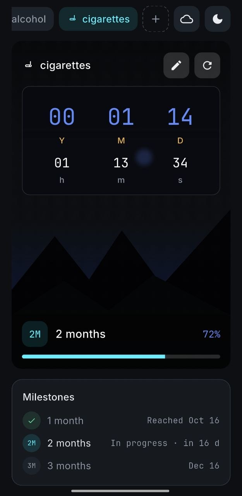
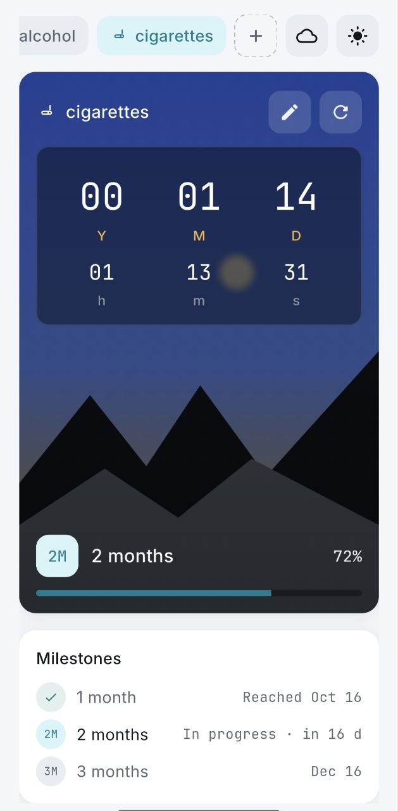

# Clean Streak - built with Flutter

Clean Streak - Habit & Streak Tracker. A lightweight streak tracker built with Flutter, designed to help you build and keep your clean streaks, one day at a time.

## Features

* **Streak trackers:** track clean streaks for any habit, with up to 20 active timers
* **Live countdown:** years, months, days, hours, minutes and seconds, updated every second
* **Milestones:** automatic progress toward your next milestone, from 1 day up and beyond, with system notifications when you reach one
* **Celebrations:** in-app celebration cards when a milestone is hit
* **Relapse & reset:** reset a streak instantly or set a custom relapse date and time in the past
* **Personalization:** choose a name, an icon and a scene background for each tracker
* **Dark & light theme:** follows the system, with a manual toggle
* **Backup:** optional backup and restore through your own Google Drive
* **Offline:** the app works entirely locally and does not require an account or an internet connection

## Privacy

Clean Streak runs entirely on your device.

Your trackers and streaks are stored locally and are not sent to a server or shared with anyone. The optional Google Drive backup stores your data in your own Drive's hidden app folder, only if you sign in and run it yourself; the app never asks for your account on its own.

No analytics. No ads. No internet connection required to work.

Built by RebelTailor. All rights reserved.

## Screenshots

  <table>
    <tr>
      <td></td>
      <td width="30"></td>
      <td></td>
    </tr>
    <tr>
      <td colspan="3" align="center"></td>
    </tr>
  </table>

